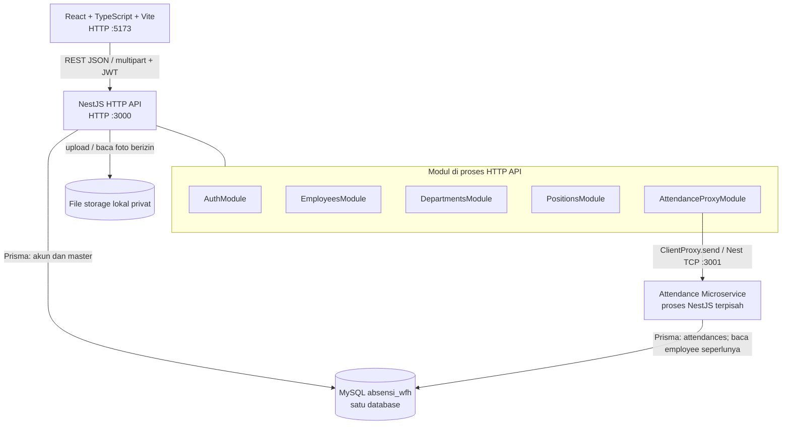
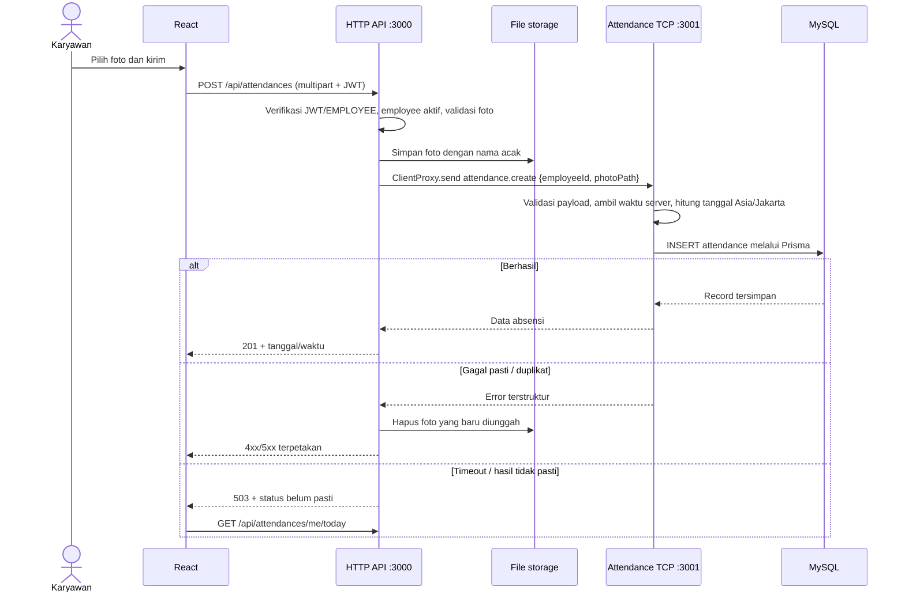

# 01 — Arsitektur Solusi

## Keputusan dan status

**[Keputusan]** MVP memakai **hybrid architecture: modular HTTP API + Attendance Microservice**, dengan **shared database for MVP**. React hanya berbicara dengan HTTP API. Dua aplikasi NestJS berjalan sebagai **dua proses terpisah**; HTTP API meneruskan operasi absensi melalui NestJS TCP `ClientProxy.send()` dan Attendance Microservice menerima melalui `@MessagePattern()`. Keputusan ini mengikuti handoff arsitektur 5 November 2026 dan diagram yang disepakati; berkas handoff tidak tersedia lagi di workspace setelah pemindahan `docs`.

**[Status aktual, 6 November 2026]** Repository masih memiliki satu proses NestJS di `absen-be/src`, `nest-cli.json` dengan `sourceRoot: "src"`, serta React/Vite. AuthModule, JWT yang diikat ke public key per sesi, signature request auth, seed, dan login/logout frontend sudah ada. Belum ada aplikasi attendance-service, komunikasi TCP, upload, atau modul master/absensi yang berjalan. `schema.prisma` dan migrasi awal enam tabel sudah ada. Diagram di bawah adalah **target implementasi**, bukan bukti seluruh sistem sudah berjalan.

## Diagram container target



`:3001` adalah **transport TCP internal NestJS**, bukan endpoint HTTP untuk browser. Port contoh development: Vite `5173`, HTTP API `3000`, attendance TCP `3001`, MySQL `3306`. Vite dev proxy `/api`, bila dibuat, hanya meneruskan HTTP ke API; ia bukan microservice ataupun API Gateway terpisah. DBeaver hanya alat developer untuk mengelola MySQL, bukan komponen jalur request.

## Tanggung jawab dan kepemilikan operasi

| Komponen | Tanggung jawab | Akses data/berkas |
| --- | --- | --- |
| React frontend | Login, check-in, riwayat, master dan monitoring HRD; mengirim HTTP request. | Tidak mengakses MySQL/TCP/storage langsung. |
| `AuthModule` di HTTP API | Login, penerbitan/verifikasi JWT, pemeriksaan akun aktif dan role. | Menulis/membaca `users`, `roles`; membaca profil seperlunya. |
| `EmployeesModule` di HTTP API | Kelola profil dan status karyawan, transaksi akun + profil. | Menulis/membaca `employees` dan `users`. |
| `DepartmentsModule`/`PositionsModule` | Menyediakan master untuk form dan validasi relasi. | Membaca `departments`/`positions`; pengelolaan awal melalui seed. |
| `AttendanceProxyModule` di HTTP API | REST adapter, RBAC, validasi/upload foto, meneruskan pesan TCP, memetakan hasil/error, melayani foto berizin. | File storage; tidak menulis `attendances`. |
| Attendance Microservice | Aturan tanggal/jam absensi, satu check-in/hari, tulis dan baca attendance, monitoring read-only. | Satu-satunya penulis `attendances`; dapat membaca `employees` untuk validasi/relasi. |

HTTP API dan microservice menggunakan Prisma terhadap database MySQL **yang sama**. Pembagian owner di atas adalah aturan kode, bukan pembatasan yang otomatis dipaksakan oleh schema atau kredensial DB saat ini. Tidak ada database-per-service, broker pesan, atau gateway mandiri pada MVP. Perubahan migrasi harus dikoordinasikan karena kedua proses bergantung pada schema bersama; ini merupakan *shared-database coupling*, sehingga solusi tidak disebut **full microservices**.

Struktur internal React, batas antarfitur, alias impor, dan konvensi file ditetapkan di [arsitektur frontend](03-arsitektur-frontend.md). Dokumen ini menjelaskan batas antaraplikasi; dokumen frontend menjelaskan organisasi kode di dalam `absen-fe/src`.

## Alur check-in dan batas tanggung jawab



Browser tidak mengirim `employeeId`, `photoPath`, `checkInAt`, atau `attendanceDate` sebagai sumber kebenaran. HTTP API memperoleh identitas dari JWT dan membuat path internal. Microservice menetapkan timestamp server dan tanggal bisnis; composite unique key DB melindungi dari request bersamaan. File dan row DB tidak atomik bersama. Foto dibersihkan jika operasi attendance **pasti gagal**; bila TCP timeout setelah kemungkinan commit, jangan langsung menghapus file yang mungkin sudah direferensikan DB. Periksa status dengan operasi baca, lalu rekonsiliasi berkas yatim. Strategi retry/idempotency lebih jauh masih perlu diputuskan.

## Alur baca dan fault handling

- HRD memanggil `GET /api/attendances` dengan JWT `ADMIN`. HTTP API memvalidasi filter dan hak akses, lalu mengirim `attendance.list` lewat TCP. Hasilnya hanya untuk dibaca.
- Karyawan memanggil `GET /api/attendances/me`; HTTP API mengirim `attendance.listByEmployee` dengan `employeeId` hasil autentikasi. Detail dan status hari ini memakai kontrak pesan tambahan yang didefinisikan sebelum implementasi.
- Foto disajikan melalui HTTP API setelah hak pemilik/ADMIN diverifikasi terhadap metadata attendance. Path berkas tidak dikembalikan sebagai URL publik.
- `ClientProxy.send()` harus memiliki timeout, pemetaan kesalahan ke HTTP yang aman, dan `requestId` untuk korelasi log. Payload pesan tetap divalidasi di microservice. Port TCP hanya pada jaringan internal.
- Jika microservice tidak tersedia, login dan master karyawan semestinya tetap berfungsi; check-in/riwayat/monitoring menampilkan kegagalan layanan yang dapat dipahami. Foto lokal hanya bekerja bila proses API memiliki akses ke direktori yang sama saat membaca; jika host dipisah, rancang shared/object storage.

## Organisasi kode yang diimplementasikan

```text
absensi-karyawan-wfh/
  absen-be/
    src/{auth,employees,departments,positions,attendances}/
    src/attendance-service/       # entrypoint Nest TCP kedua
    src/contracts/                # DTO/pattern internal bersama
    prisma/
  absen-fe/
  docs/
```

`attendances/` di HTTP API adalah adapter HTTP/upload/proxy, bukan owner operasi Prisma pada tabel attendance. Entrypoint kedua di `src/attendance-service/main.ts` menjalankan proses TCP nyata. Prisma Client memakai output default `@prisma/client`. Perintah build dan script kedua proses sudah diuji; rincian bukti ada di [progres](../06-implementation-planning/07-implementation-progress.md).

## Keputusan arsitektur (ADR ringkas)

| ID | Keputusan | Alasan | Konsekuensi |
| --- | --- | --- | --- |
| ADR-01 | REST JSON/multipart di HTTP API; Nest TCP request-response di dalam backend. | Satu entry point web, microservice nyata. | Kontrak HTTP dan message pattern harus diuji bersama. |
| ADR-02 | Dua proses NestJS: modular HTTP API + Attendance Microservice. | Memenuhi demonstrasi komunikasi antarproses dalam batas waktu tes. | Dua lifecycle, konfigurasi port, timeout, dan monitoring. |
| ADR-03 | Shared MySQL `absensi_wfh` untuk MVP, akses Prisma dengan owner operasi. | Mempertahankan schema/migrasi yang sudah dibuat. | Coupling schema; belum independen secara data. |
| ADR-04 | HTTP API menyimpan foto lokal; microservice menerima `photoPath`. | Multipart hanya ditangani satu entry point. | Perlu cleanup/reconciliation dan storage bersama jika host terpisah. |
| ADR-05 | Waktu server + tanggal bisnis `Asia/Jakarta`, konvensi timestamp UTC. | Menjaga integritas hari absensi. | Perlu tes batas tengah malam dan timezone. |
| ADR-06 | JWT dan role `ADMIN`/`EMPLOYEE`; backend sumber otorisasi. | Sesuai aktor dan skema role. | Seed role, bcrypt, JWT dan auth guard sudah ada; guard role endpoint domain dipakai saat endpoint tersebut dibuat. |

**D-07 [Keputusan auth]:** React menandatangani request auth dengan kunci asimetris per sesi, dan HTTP API mengikat public key ke JWT. Ini tidak memakai HMAC global backend di browser. [Kontrak signature](04-evaluasi-signature-request.md#kontrak-yang-dipilih-untuk-endpoint-autentikasi) berlaku untuk login/me/logout; signature internal ke Attendance Microservice tetap keputusan terpisah.

## Target nonfungsional

RBAC dan validasi pada HTTP API; validasi ulang payload internal di microservice; password hash kuat; file privat; TCP tidak diekspos publik; timeout dan korelasi log; pagination daftar; backup DB bersama berkas foto. Kriteria penerimaan lintas proses ada di [rencana produk](../04-product-management/02-rencana-dan-penerimaan.md), dan detail kontrak ada di [kontrak API](02-kontrak-api-dan-keamanan.md).
