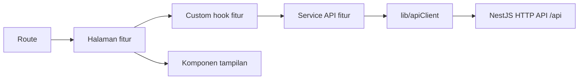

# 03 — Arsitektur Frontend React

## Status dan batas sistem

Frontend memakai pendekatan **feature-based / colocation**: kode yang berubah bersama karena satu kebutuhan bisnis ditempatkan di fitur yang sama. Per 6 November 2026, fitur auth, attendance, dan employees, alias `@/` pada TypeScript/Vite, Vite proxy `/api`, serta layar domain telah diterapkan. Navigasi memakai History API di `src/lib/navigation.ts` tanpa paket routing tambahan. Hasil verifikasi dan gap ada di [progres](../06-implementation-planning/07-implementation-progress.md).

React hanya memanggil **NestJS HTTP API** pada prefix `/api`. Browser tidak menghubungi Attendance Microservice TCP, MySQL, atau penyimpanan foto secara langsung. Kontrak HTTP dan hak akses mengikuti [kontrak API](02-kontrak-api-dan-keamanan.md); daftar layar serta route mengikuti [navigasi UI/UX](../05-ui-ux-design/01-navigasi-dan-alur.md). Struktur frontend ini tidak mengubah keputusan dua proses backend dan shared database MVP.

## Struktur target

```text
absen-fe/src/
├── main.tsx                         # Bootstrap aplikasi dan provider tingkat aplikasi
├── App.tsx                          # Komposisi route dan layout; bukan tempat logika fitur
├── assets/                          # Aset statis dan style global yang benar-benar global
├── components/ui/                   # Button, Input, Modal, EmptyState yang dipakai lintas fitur
├── layouts/                         # EmployeeLayout dan AdminLayout
├── lib/                             # apiClient, format tanggal, helper lintas fitur
├── routes/                          # Definisi route dan penjaga navigasi berbasis role
└── features/
    ├── auth/
    │   ├── components/              # LoginForm
    │   ├── context/                 # AuthProvider; tetap milik fitur auth
    │   ├── hooks/                   # useAuth, useLogin
    │   ├── pages/                   # LoginPage
    │   ├── services/                # authApi
    │   ├── types.ts                 # Tipe request/response auth
    │   └── index.ts                 # Ekspor publik minimum fitur
    ├── attendance/
    │   ├── components/              # CheckInForm, AttendanceList, AttendanceDetail
    │   ├── hooks/                   # useTodayAttendance, useAttendanceList
    │   ├── pages/                   # Beranda, riwayat, monitoring, detail
    │   ├── services/                # attendanceApi
    │   ├── utils/                   # Validasi foto murni untuk UX
    │   ├── types.ts                 # Tipe absensi pada batas HTTP
    │   └── index.ts
    └── employees/
        ├── components/              # EmployeeForm, EmployeeTable
        ├── hooks/                   # useEmployeeManagement
        ├── pages/                   # Daftar, tambah, dan ubah karyawan
        ├── services/                # employeeApi; lookup departemen/jabatan untuk form
        ├── types.ts                 # Tipe master karyawan
        └── index.ts
```

Pohon di atas menunjukkan **lokasi saat file diperlukan**, bukan perintah membuat semua folder kosong. Style yang khusus untuk satu komponen diletakkan di sebelah komponen tersebut, misalnya `LoginForm.tsx` bersama `login-form.module.css`. Departemen dan jabatan tetap di `employees/services` selama hanya dipakai oleh form karyawan; jika kelak menjadi fitur mandiri, pindahkan berdasarkan kebutuhan nyata.

## Pemetaan route ke fitur

| Route rancangan | Fitur pemilik halaman | Akses |
| --- | --- | --- |
| `/login` | `auth` | Publik |
| `/app`, `/app/riwayat`, `/app/riwayat/:id` | `attendance` | `EMPLOYEE`, hanya data sendiri |
| `/admin/absensi`, `/admin/absensi/:id` | `attendance` | `ADMIN`, baca saja |
| `/admin/karyawan`, `/admin/karyawan/baru`, `/admin/karyawan/:id` | `employees` | `ADMIN` |

`routes/` menyusun halaman fitur dan layout, menangani redirect serta keadaan 401/403/404 untuk UX. Route guard frontend tidak menggantikan pemeriksaan JWT/role di HTTP API. Navigasi awal memakai History API melalui `lib/navigation.ts` dan `components/ui/AppLink.tsx`; bila kebutuhan routing bertambah, keputusan penggunaan paket router dicatat di sini sebelum migrasi.

## Aturan dependensi dan impor

1. `routes/` dan `App.tsx` menjadi titik komposisi. Keduanya boleh mengimpor halaman/provider yang **diekspor melalui `features/<nama>/index.ts`** dan layout bersama.
2. Sebuah fitur boleh mengimpor `components/ui`, `layouts` bila relevan, dan `lib`. Fitur tidak mengimpor langsung `components/`, `hooks/`, atau `services/` milik fitur lain. Bila perlu memakai kemampuan fitur lain, ekspos kontrak publik sekecil mungkin dari `index.ts` atau pindahkan kemampuan yang benar-benar umum ke folder bersama.
3. `components/ui` dan `lib` tidak mengimpor fitur. `lib/apiClient.ts` menangani base URL, header, parsing respons/error, dan transport umum; ia tidak berisi endpoint khusus karyawan/absensi dan tidak mengimpor `auth` sehingga tidak membuat dependensi melingkar.
4. `services/` di dalam fitur berisi panggilan endpoint milik fitur. Contoh: `authApi.ts` memanggil `/api/auth/*`, `attendanceApi.ts` memanggil `/api/attendances*`, dan `employeeApi.ts` memanggil `/api/employees*` serta lookup master untuk form. Jangan membuat `src/services` global hanya untuk mengumpulkan seluruh endpoint.
5. `types.ts` milik fitur mencerminkan kontrak HTTP yang dipakai UI, bukan model Prisma. Tipe yang benar-benar dipakai banyak fitur dapat dipindah ke `src/types/` ketika kebutuhannya terbukti. Folder `src/context/` dan `src/hooks/` global juga hanya dibuat untuk kebutuhan lintas fitur; `AuthProvider` dan `useAuth` tetap di `features/auth` dengan ekspor publik yang terkontrol.

`AuthProvider` memegang JWT di memori sesuai [kontrak keamanan](02-kontrak-api-dan-keamanan.md). Hook fitur lain boleh memakai `useAuth` yang diekspor dari `features/auth/index.ts`, lalu meneruskan token ke service fitur dan `apiClient`; `lib` tidak membaca context React atau mengimpor fitur auth. Ketika API mengembalikan 401, hook/provider membersihkan sesi dan route mengarahkan pengguna ke login.

**Signature request auth [Keputusan]:** `lib/apiClient.ts` membuat **satu timestamp dan nonce per request** serta meminta proof dari utilitas Web Crypto bersama sebelum fetch auth. Pasangan kunci P-256 dibuat saat login, hanya disimpan di memori, dipakai kembali untuk `/me` dan `/logout`, lalu dibuang saat logout/sesi habis. Digest berasal dari bytes body yang benar-benar dikirim. Kunci HMAC backend tidak pernah masuk ke `VITE_*`, bundle, atau respons login. Detail header dan canonicalization ada di [kontrak signature](04-evaluasi-signature-request.md#kontrak-yang-dipilih-untuk-endpoint-autentikasi). Penerapan pada upload multipart dan endpoint domain memerlukan pemeriksaan raw bytes serta tes tersendiri.

## Alias impor `@/`

**[Terimplementasi]** Alias `@/` menunjuk ke `absen-fe/src`. Konfigurasi TypeScript dan Vite telah diselaraskan; mengubah satu sisi saja membuat editor atau bundler gagal menemukan modul.

```jsonc
// absen-fe/tsconfig.app.json, di dalam compilerOptions
"paths": { "@/*": ["./src/*"] }
```

```ts
// absen-fe/vite.config.ts setelah alias diterapkan
import react from '@vitejs/plugin-react'
import { fileURLToPath } from 'node:url'
import { defineConfig } from 'vite'

export default defineConfig({
  plugins: [react()],
  resolve: {
    alias: { '@': fileURLToPath(new URL('./src', import.meta.url)) },
  },
})
```

Gunakan `@/` untuk impor lintas folder, misalnya `@/components/ui/Button` atau `@/features/auth` dari `routes/`. Impor relatif yang pendek **di dalam fitur yang sama** tetap dapat dipakai, misalnya `./LoginForm`; hindari rangkaian `../../../`. Setelah alias diterapkan di kode, `pnpm build` pada `absen-fe` harus membuktikan TypeScript dan Vite sama-sama dapat me-resolve impor tersebut.

## Pembagian logika



| Lapisan | Tanggung jawab | Contoh |
| --- | --- | --- |
| `services/` fitur | Memanggil HTTP API dan mengubah respons transport menjadi tipe fitur; tidak menyimpan state React. | `attendanceApi.create(formData)` |
| `hooks/` fitur | Mengelola state, efek, loading/error, submit, serta sinkronisasi hasil API. | `useTodayAttendance()` memeriksa status sebelum retry setelah timeout. |
| `utils/` fitur | Fungsi murni yang bisa dipakai tanpa React; validasi lokal untuk UX, bukan pengganti validasi server. | `validatePhoto(file)` |
| `components/` fitur | Menampilkan data dan meneruskan aksi melalui props; logika tampilan sederhana boleh tetap di komponen. | `CheckInForm` menerima status dan `onSubmit`. |
| `pages/` fitur | Menyusun hook dan komponen untuk satu route. | `AttendanceHomePage` |

Logika otorisasi dan aturan satu absensi per hari tetap milik backend. Frontend dapat menyembunyikan tombol atau memberi validasi awal, tetapi tidak boleh menjadikannya satu-satunya pengaman. Untuk upload foto, UI mengirim `multipart/form-data` ke HTTP API; setelah timeout, hook memeriksa status hari ini sebelum menawarkan pengiriman ulang, sesuai [alur UX](../05-ui-ux-design/01-navigasi-dan-alur.md#alur-tugas-karyawan).

## Konvensi penamaan dan style

| Jenis | Konvensi | Contoh |
| --- | --- | --- |
| Komponen, halaman, provider, layout | `PascalCase.tsx` | `LoginForm.tsx`, `EmployeeLayout.tsx` |
| Custom hook | `camelCase.ts`, awalan `use` | `useEmployeeManagement.ts` |
| Layanan API dan utilitas | `camelCase.ts` | `attendanceApi.ts`, `formatDate.ts` |
| Folder fitur | `kebab-case` bila lebih dari satu kata | `auth/`, `attendance/`, `employee-management/` bila nama domain itu dipilih |
| Style khusus komponen | `kebab-case.module.css` | `login-form.module.css` |
| Style global | Nama jelas di `assets/` atau root `src` | `index.css` untuk reset/tokens global |

Satu konvensi dipakai konsisten; hindari campuran `UserProfile.tsx`, `user_profile.tsx`, dan `userProfile.tsx` untuk jenis file yang sama. Jangan memindahkan style komponen ke CSS global hanya karena fitur masih kecil.

## Kriteria review saat implementasi frontend

- Halaman baru memiliki pemilik fitur yang jelas; state dan API tidak menumpuk di `App.tsx`.
- Tidak ada impor lintas fitur menuju folder internal fitur lain atau panggilan langsung ke TCP/MySQL.
- Alias `@/` bekerja di editor/TypeScript dan build Vite; route sesuai spesifikasi UI/UX.
- Komponen utama memiliki keadaan loading, kosong, error, berhasil, dan akses ditolak yang relevan.
- `pnpm build` dan `pnpm lint` frontend lulus setelah kode/config benar-benar diubah. Keduanya dijalankan saat implementasi auth 6 November 2026.
