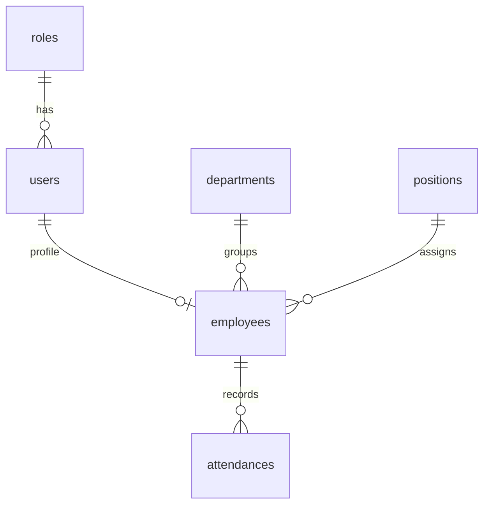

# 01 — Model Data dan Kamus Data

Dokumen ini mendeskripsikan **keadaan yang sudah tertulis** dalam [`schema.prisma`](../../prisma/schema.prisma) dan migrasi awal, bukan fitur runtime. DBMS: MySQL (target MySQL 8 menurut handoff arsitektur 5 November 2026); ORM: Prisma 6.19.0 sesuai `package.json`; nama tabel/kolom memakai `snake_case` melalui `@map`/`@@map`, properti Prisma memakai `camelCase`. Diagram ringkas yang sudah tersedia: [`database_relation.svg`](database_relation.svg). Diagram berikut menonjolkan kardinalitas; skema adalah sumber paling lengkap untuk tipe dan indeks.

## Ringkasan entitas

| Entitas | Tujuan | Kunci/relasi penting |
| --- | --- | --- |
| `roles` | Kategori hak akses akun. | `code` unik; satu role ke banyak user. |
| `users` | Identitas login dan status akun. | `email` unik; `role_id` wajib; satu user maksimal satu employee. |
| `departments` | Master departemen. | `code` unik; satu departemen ke banyak employee. |
| `positions` | Master jabatan. | `code` unik; satu jabatan ke banyak employee. |
| `employees` | Profil karyawan. | `employee_code` dan `user_id` unik; FK wajib ke user, departemen, jabatan. |
| `attendances` | Satu check-in WFH beserta referensi foto. | Unik (`employee_id`, `attendance_date`); FK ke employee. |

## Ownership operasi dalam hybrid architecture

| Tabel / aset | Owner tulis pada MVP | Pembaca yang diperlukan | Catatan |
| --- | --- | --- | --- |
| `roles`, `users` | HTTP API (`AuthModule`/`EmployeesModule`), ditambah seed awal | HTTP API | Role `ADMIN`/`EMPLOYEE` dibuat oleh seed development; bukan enum schema. |
| `departments`, `positions` | Seed awal; API master bila kelak ditambahkan | HTTP API | Bukan role; tetap satu database. |
| `employees` | HTTP API (`EmployeesModule`) | HTTP API; Attendance Microservice seperlunya untuk validasi/FK | Ubah akun dan profil dalam transaksi API. |
| `attendances` | **Attendance Microservice saja** | Attendance Microservice; hasil baca dikirim ke HTTP API via TCP | HTTP API tidak melakukan CRUD Prisma langsung ke tabel ini. |
| File foto lokal | HTTP API | HTTP API setelah otorisasi | `photo_path` disimpan oleh microservice sebagai metadata; file tidak berada di MySQL. |

Semua tabel domain tetap berada dalam **satu MySQL `absensi_wfh` untuk MVP**. Pemisahan owner adalah aturan aplikasi, bukan isolasi database-per-service. Kedua proses memerlukan koordinasi migrasi dan kompatibilitas Prisma Client; `_prisma_migrations` adalah tabel internal Prisma, bukan entitas domain.

## Kamus data fisik

Notasi: `PK` primary key; `UK` unique; `FK` foreign key; `NN` tidak nullable; `?` nullable. `DateTime` tanpa anotasi DB spesifik mengikuti pemetaan Prisma untuk MySQL; waktu tidak memiliki zona waktu tersimpan.

### `roles` / `Role`

| Kolom (properti Prisma) | Tipe | Kewajiban / nilai awal | Makna |
| --- | --- | --- | --- |
| `id` (`id`) | INT | PK, auto increment | Identitas role. |
| `code` (`code`) | VARCHAR(30) | NN, UK | Kode stabil untuk otorisasi; nilai seed ada pada `prisma/seed.ts`. |
| `name` (`name`) | VARCHAR(100) | NN | Label role. |
| `created_at` (`createdAt`) | DATETIME(3) | NN, `now()` | Waktu pembuatan. |

### `users` / `User`

| Kolom | Tipe | Kewajiban / nilai awal | Makna |
| --- | --- | --- | --- |
| `id` | INT | PK, auto increment | Identitas akun. |
| `email` | VARCHAR(191) | NN, UK | Login; normalisasi email aplikasi harus konsisten. |
| `password_hash` (`passwordHash`) | VARCHAR(255) | NN | Hash, bukan kata sandi mentah. |
| `role_id` (`roleId`) | INT | NN, FK ke `roles.id`, indeks | Peran akun. |
| `is_active` (`isActive`) | BOOLEAN | NN, default `true` | Status akun. |
| `created_at` (`createdAt`) | DATETIME(3) | NN, `now()` | Waktu buat. |
| `updated_at` (`updatedAt`) | DATETIME(3) | NN, `@updatedAt` | Waktu ubah oleh Prisma. |

Relasi `employee Employee?` berarti user HRD dapat tidak mempunyai baris `employees`. Skema **tidak** memastikan hanya role karyawan yang mempunyai profil employee; validasi itu milik aplikasi.

### `departments` / `Department`

| Kolom | Tipe | Kewajiban / nilai awal | Makna |
| --- | --- | --- | --- |
| `id` | INT | PK, auto increment | Identitas departemen. |
| `code` | VARCHAR(30) | NN, UK | Kode departemen. |
| `name` | VARCHAR(100) | NN | Nama departemen. |
| `is_active` (`isActive`) | BOOLEAN | NN, default `true` | Pilihan aktif untuk karyawan baru. |
| `created_at` (`createdAt`) | DATETIME(3) | NN, `now()` | Waktu buat. |
| `updated_at` (`updatedAt`) | DATETIME(3) | NN, `@updatedAt` | Waktu ubah. |

### `positions` / `Position`

Kolom identik secara struktur dengan `departments`: `id` INT PK auto increment; `code` VARCHAR(30) NN UK; `name` VARCHAR(100) NN; `is_active` BOOLEAN NN default `true`; `created_at` DATETIME(3) NN default `now()`; `updated_at` DATETIME(3) NN `@updatedAt`. Maknanya adalah master jabatan, bukan departemen.

### `employees` / `Employee`

| Kolom | Tipe | Kewajiban / nilai awal | Makna |
| --- | --- | --- | --- |
| `id` | INT | PK, auto increment | Identitas internal karyawan. |
| `employee_code` (`employeeCode`) | VARCHAR(30) | NN, UK | Nomor/kode karyawan. |
| `full_name` (`fullName`) | VARCHAR(150) | NN, indeks | Nama untuk pencarian/tampilan. |
| `user_id` (`userId`) | INT | NN, UK, FK ke `users.id` | Satu profil per akun. |
| `department_id` (`departmentId`) | INT | NN, FK ke `departments.id`, indeks | Departemen saat ini. |
| `position_id` (`positionId`) | INT | NN, FK ke `positions.id`, indeks | Jabatan saat ini. |
| `phone_number` (`phoneNumber`) | VARCHAR(20) | ? | Nomor kontak opsional. |
| `hire_date` (`hireDate`) | DATE | ? | Tanggal bergabung, tanpa jam. |
| `is_active` (`isActive`) | BOOLEAN | NN, default `true` | Status profil karyawan. |
| `created_at` (`createdAt`) | DATETIME(3) | NN, `now()` | Waktu buat. |
| `updated_at` (`updatedAt`) | DATETIME(3) | NN, `@updatedAt` | Waktu ubah. |

### `attendances` / `Attendance`

| Kolom | Tipe | Kewajiban / nilai awal | Makna |
| --- | --- | --- | --- |
| `id` | INT | PK, auto increment | Identitas absensi. |
| `employee_id` (`employeeId`) | INT | NN, FK ke `employees.id` | Pemilik absensi. |
| `attendance_date` (`attendanceDate`) | DATE | NN, UK bersama `employee_id`; indeks bersama `check_in_at` | Tanggal bisnis absensi. |
| `check_in_at` (`checkInAt`) | DATETIME(3) | NN | Waktu check-in dari server hingga milidetik. |
| `photo_path` (`photoPath`) | VARCHAR(500) | NN | Lokasi/referensi foto privat; bukan isi foto. |
| `created_at` (`createdAt`) | DATETIME(3) | NN, `now()` | Waktu catatan DB dibuat. |

`check_in_at` dan `created_at` berbeda konsep. Keduanya dapat berdekatan, tetapi jangan gunakan `created_at` sebagai pengganti waktu absensi pada UI. Skema belum menyimpan `check_out_at`, status terlambat, koordinat, approval, maupun riwayat perubahan.

HTTP API membuat `photoPath` internal setelah upload dan mengirimkannya bersama `employeeId` terverifikasi melalui pesan TCP `attendance.create`; Attendance Microservice mengisi `attendanceDate`, `checkInAt`, dan menulis row. `photoPath` tidak boleh dikembalikan sebagai path publik. Perubahan lokasi file ke host terpisah memerlukan storage bersama/object storage; schema VARCHAR(500) tetap dapat menyimpan referensi logis jika formatnya dirancang konsisten.

## Kardinalitas dan penghapusan

Semua FK di migrasi awal memakai `ON DELETE RESTRICT` dan `ON UPDATE CASCADE`. Role, user, departemen, jabatan, atau karyawan yang direferensikan tidak bisa dihapus fisik tanpa menangani data anak. `users` dapat mempunyai 0 atau 1 `employees`; satu `employee` wajib punya tepat satu `user`, `department`, dan `position`; satu employee dapat punya banyak attendance di tanggal berbeda.

## Indeks yang tersedia

- Unique: `roles.code`, `users.email`, `departments.code`, `positions.code`, `employees.employee_code`, `employees.user_id`, dan pasangan `attendances(employee_id, attendance_date)`.
- Non-unique: `users.role_id`, `employees.department_id`, `employees.position_id`, `employees.full_name`, dan `attendances(attendance_date, check_in_at)`.
- Pola filter HRD perlu diukur terhadap indeks ini; jangan menambah indeks tanpa profil query atau kebutuhan yang nyata.

Lihat [integritas dan siklus data](02-integritas-dan-siklus-data.md) untuk aturan yang **tidak** dijamin oleh skema serta prosedur migrasi/seed.
