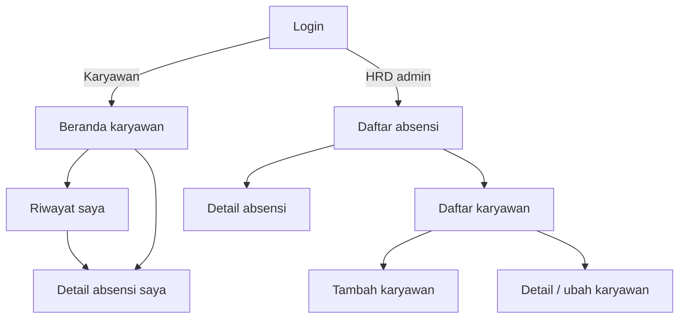
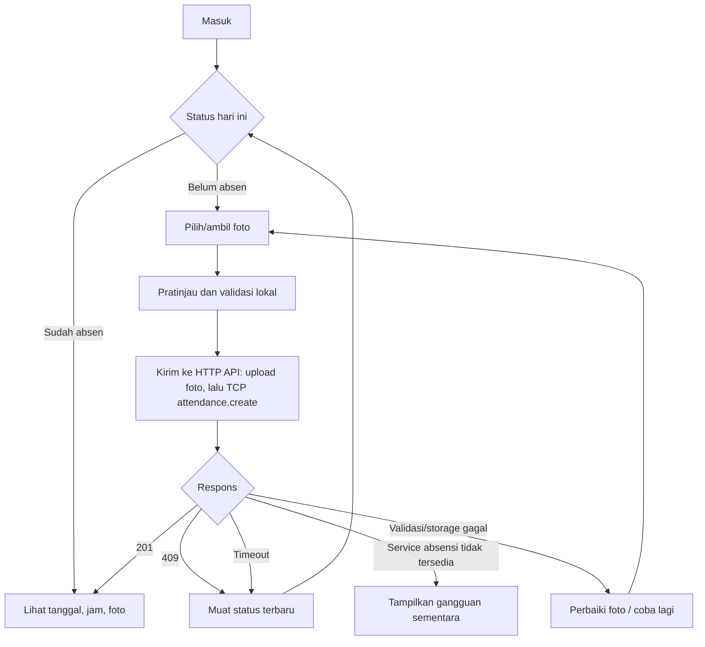

# 01 — Navigasi, Prinsip UX, dan Alur Tugas

Dokumen ini adalah **[Rancangan]** pengalaman pengguna yang menjadi acuan layar aplikasi. Fokusnya dua persona di [PRD](../04-product-management/01-kebutuhan-produk.md). React hanya memanggil HTTP API `/api`; komunikasi TCP ke Attendance Microservice adalah urusan backend dan tidak terlihat sebagai endpoint browser. Organisasi kode React dijelaskan di [arsitektur frontend](../02-solution-architecture/03-arsitektur-frontend.md). Antarmuka harus mencerminkan hak akses backend, tetapi penyembunyian menu bukan mekanisme keamanan. Role teknis `ADMIN` ditampilkan sebagai “HRD”.

## Prinsip desain

1. **Status lebih penting daripada aksi.** Halaman karyawan langsung menjawab “sudah absen hari ini?” beserta tanggal/jamnya.
2. **Satu tindakan utama per layar.** Check-in mempunyai satu tombol jelas; form HRD membedakan simpan dan batal.
3. **Bukti yang dapat diverifikasi.** Setelah check-in tampilkan waktu hasil server dan pratinjau foto; HRD dapat melihat detail tanpa mengubahnya.
4. **Kesalahan dapat dipulihkan.** Pesan menjelaskan apa yang gagal dan langkah berikutnya; timeout mendorong pemeriksaan status sebelum kirim ulang.
5. **Aman secara default.** Foto tidak berada pada URL publik, tidak menampilkan path internal, dan akses lintas peran dialihkan secara jelas.
6. **Responsif dan inklusif.** Karyawan dapat memakai ponsel; HRD efisien di desktop; semua kontrol dapat dipakai dengan keyboard dan label yang jelas.

## Arsitektur informasi

| Area | Route rancangan | Navigasi utama | Akses |
| --- | --- | --- | --- |
| Login | `/login` | Tanpa menu aplikasi | Publik |
| Beranda karyawan | `/app` | Beranda, Riwayat | Karyawan |
| Riwayat karyawan | `/app/riwayat` | Beranda, Riwayat | Karyawan |
| Detail pribadi | `/app/riwayat/:id` | Breadcrumb/kembali | Pemilik |
| Monitoring HRD | `/admin/absensi` | Absensi, Karyawan | HRD |
| Detail absensi HRD | `/admin/absensi/:id` | Breadcrumb/kembali | HRD |
| Daftar karyawan | `/admin/karyawan` | Absensi, Karyawan | HRD |
| Tambah/ubah karyawan | `/admin/karyawan/baru`, `/admin/karyawan/:id` | Breadcrumb/kembali | HRD |

**Navigasi global:** logo/nama produk, area sesuai role, identitas singkat, tombol Keluar. Di ponsel gunakan menu ringkas yang tetap terlihat/terbuka dengan keyboard. Jangan tampilkan menu HRD kepada karyawan; bila route salah dibuka langsung, UI menampilkan akses ditolak setelah API/identitas diverifikasi.

## Alur tugas karyawan

Detail interaksi: tampilkan bahwa tanggal/jam ditentukan sistem saat pengiriman (di Attendance Microservice). Tombol kirim nonaktif selama request berjalan. Foto dipilih ulang bila pengguna menghapus pratinjau. Jika 409, tampilkan absensi yang sudah tercatat. Jika timeout, status belum pasti sehingga baca `GET /api/attendances/me/today` terlebih dulu; bila pemeriksaan juga gagal, jangan menyatakan absensi berhasil atau gagal pasti. Kompresi foto di klien boleh menjadi peningkatan, tetapi HTTP API tetap memvalidasi hasilnya.

Setelah check-in hari ini berhasil, karyawan pemilik dapat `Ganti foto` atau `Hapus absensi` dari status/detail. Ganti foto mempertahankan tanggal/jam asli; hapus meminta konfirmasi yang menyatakan catatan dan foto akan hilang serta check-in ulang diperbolehkan. Tombol tidak tersedia untuk hari lampau. Hasil timeout diperiksa ulang sebelum menyatakan mutasi berhasil/gagal. HRD tidak melihat tombol mutasi.

## Alur tugas HRD

### Membuat atau memperbarui karyawan

Daftar karyawan → `Tambah karyawan` → isi kode, nama, email, password awal, departemen, jabatan, field opsional → periksa error per field → simpan → detail/daftar dengan notifikasi berhasil. Pada edit, password awal tidak ditampilkan; perubahan password tidak diselipkan sebagai field edit profil tanpa rancangan khusus. Penonaktifan memakai dialog konfirmasi yang menyebut bahwa login berhenti dan histori tetap tersedia. Batal kembali tanpa menyimpan.

### Melihat absensi

Daftar absensi → pilih rentang tanggal dan filter opsional → HTTP API mengambil data dari microservice via TCP → lihat jumlah hasil dan urutan → buka detail → lihat identitas karyawan, departemen/jabatan terkini, tanggal/jam, foto bukti → kembali ke daftar dengan filter yang masih terjaga. Tidak ada tombol edit/hapus/approve. Jika foto gagal dimuat, metadata absensi tetap tampil disertai pesan dan aksi coba lagi. Jika service attendance mati, pertahankan filter dan tawarkan coba lagi; navigasi master karyawan tetap dapat digunakan.

## Pola keadaan UI bersama

| Keadaan | Perilaku |
| --- | --- |
| Memuat | Indikator/skeleton seperlunya; cegah klik ganda, jangan kosong tanpa penjelasan. |
| Kosong | Jelaskan belum ada data atau filter tidak menemukan hasil; tawarkan reset filter bila relevan. |
| Berhasil | Konfirmasi dengan objek dan waktu yang tersimpan, bukan hanya toast yang cepat hilang. |
| Validasi | Tampilkan error dekat field dan ringkasan jika banyak kesalahan; fokus ke error pertama. |
| Jaringan gagal | Pertahankan input yang aman, beri coba lagi; untuk check-in verifikasi status sebelum ulang. |
| Service attendance tidak tersedia | Jelaskan absensi/monitoring sementara tidak dapat dimuat, pertahankan konteks, beri coba lagi; login/master HRD tidak ikut diblokir. |
| Tidak berizin | Pesan sederhana dan tautan ke area yang benar; backend tetap mengembalikan 403. |
| Sesi habis | Arahkan login, simpan tujuan navigasi bila aman; jangan pertahankan token lama. |
| Data hilang (404) | Jelaskan data tidak ditemukan dan berikan kembali ke daftar. |

**Pemulihan sesi:** Pada refresh atau browser dibuka kembali, tampilkan `Memeriksa sesi…` hingga JWT dan kunci proof persisten dipulihkan serta `/me` berhasil. Jangan arahkan sesaat ke login atau mengulang toast sukses. Jika jaringan tidak tersedia, tampilkan `Sesi belum dapat diverifikasi` dengan `Coba lagi` dan `Masuk ulang`; hanya aksi kedua membuang sesi lokal. JWT kedaluwarsa, kunci hilang, atau 401 mengarah ke login dengan pesan sesi berakhir. Masa hidup JWT tetap 30 menit.

Rincian elemen tiap layar dan teks ada di [spesifikasi layar](02-spesifikasi-layar.md). Pola notifikasi setelah navigasi, interaksi, gerak, dan kedalaman visual dijabarkan di [umpan balik interaksi dan sistem visual](03-umpan-balik-interaksi-dan-sistem-visual.md).
